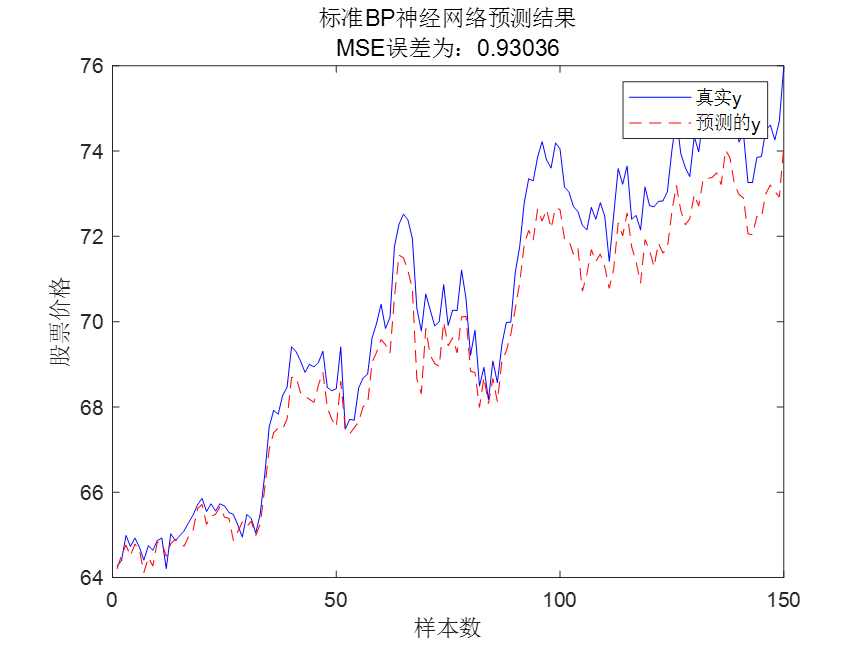
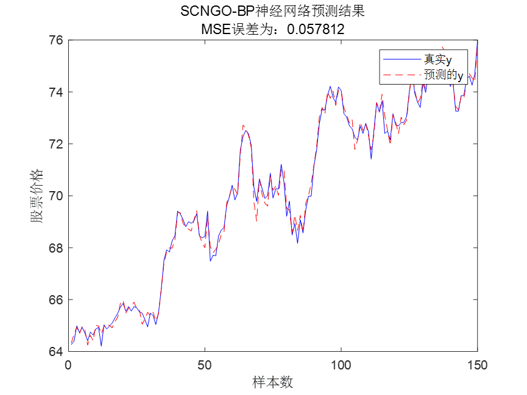
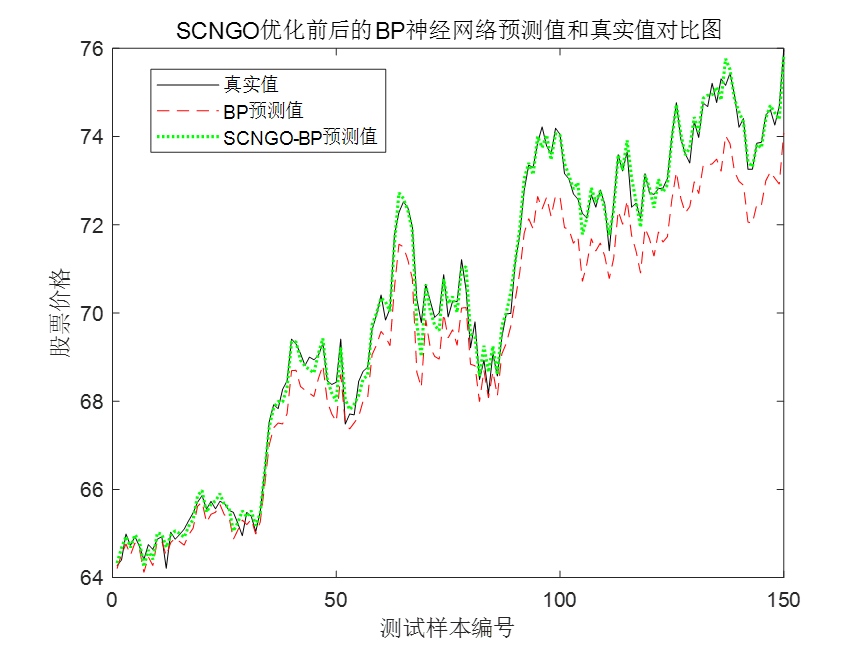
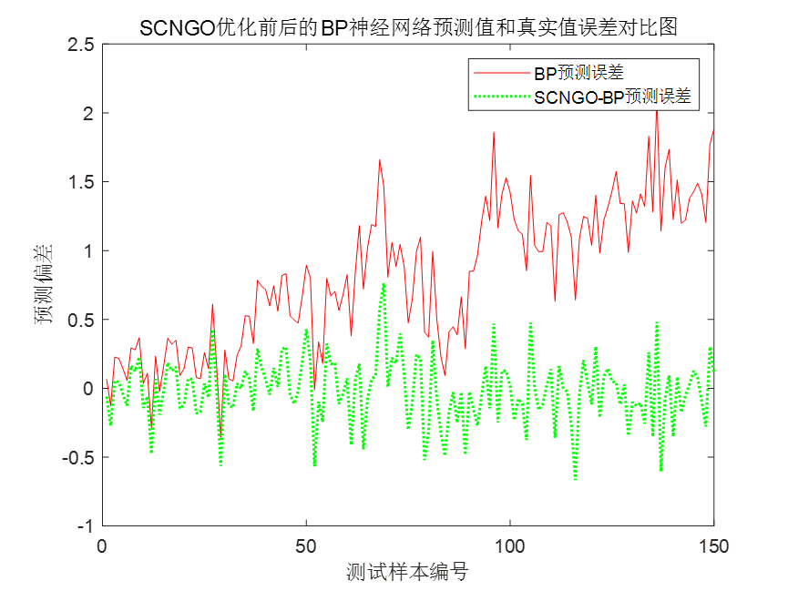
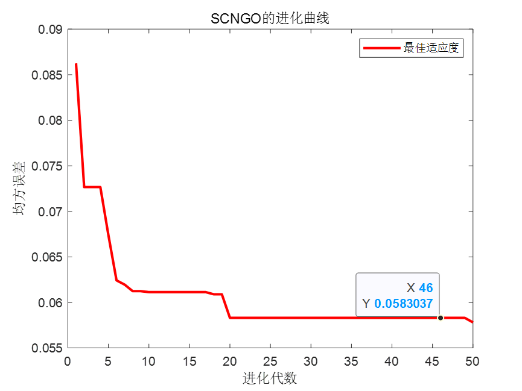
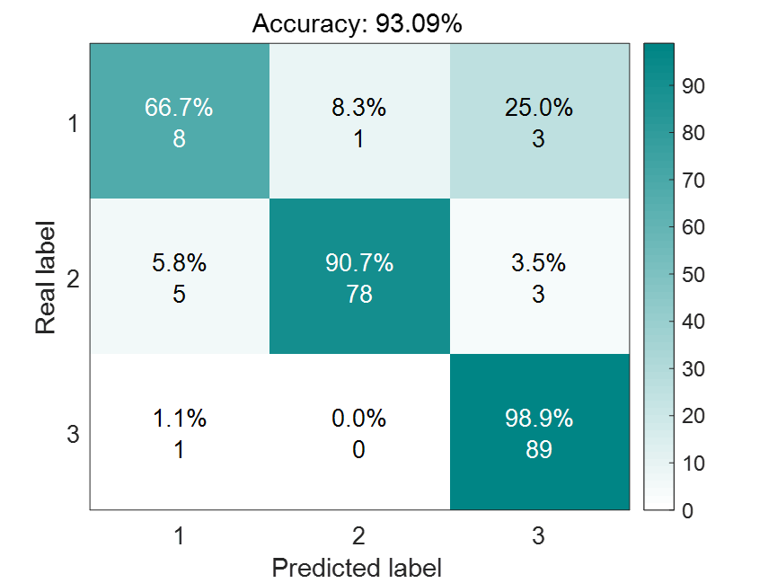
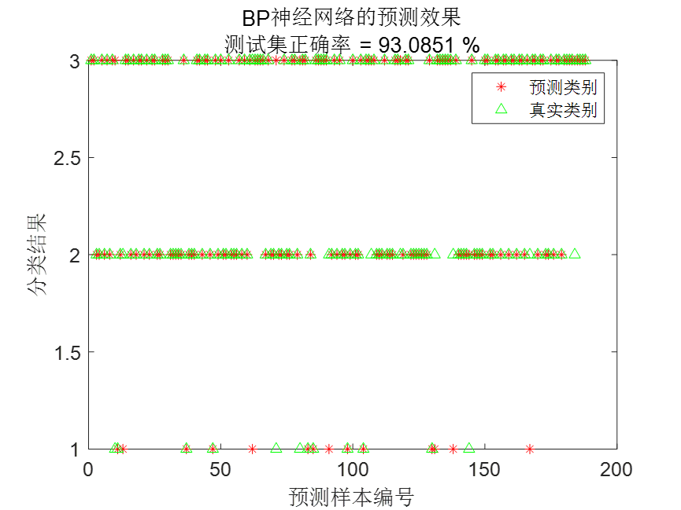
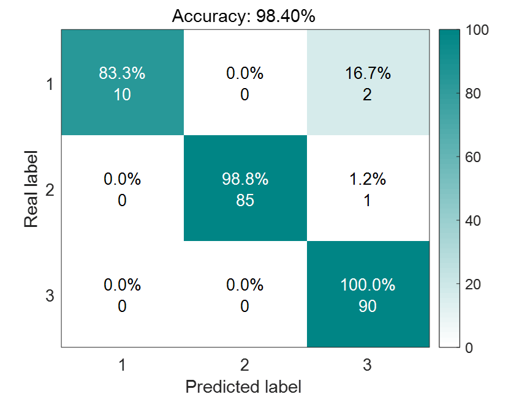
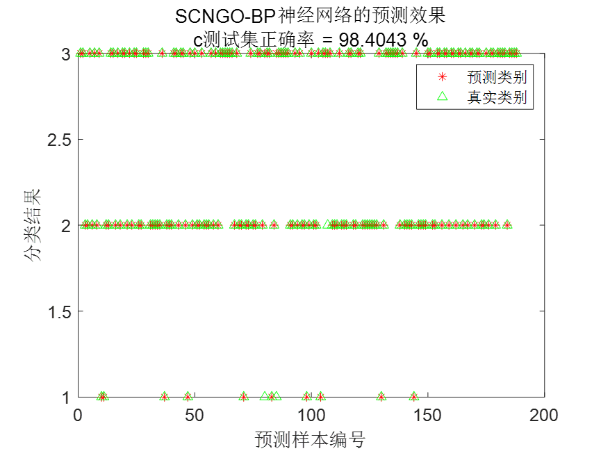
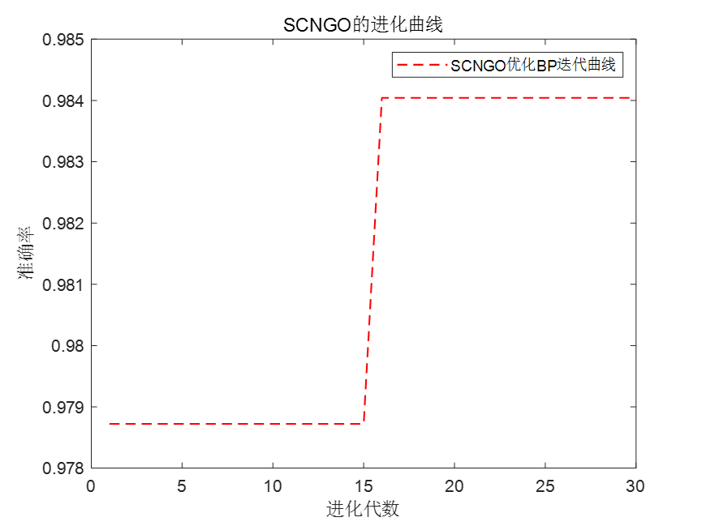

# Improved Northern Eagle Algorithm Optimized BP Neural Network - Two Cases of Regression and Classification

The link provides a detailed introduction to the product. 
In this article, we discuss two cases: regression and classification. In the regression case, an example of classic stock data is used. For the classification case, a common UCI dataset is chosen. 
The initial weights and thresholds of the BP neural network are randomly generated, so they may not be optimal. An intelligent algorithm is employed to optimize the weights and thresholds of the BP neural network, ensuring a more perfect mapping between inputs and outputs, thereby improving the accuracy of the BP neural network model. This article uses the SCNGO algorithm to optimize the weights and thresholds of the BP neural network and applies it to actual regression and classification cases. 
01 Stock Prediction Case 
Although the case is about stock prediction, the SCNGO-BP prediction model is universal and can be directly replaced with your own data. 
Standard BP model prediction results: 
It can be seen that the standard BP neural network's prediction effect is not very ideal, unable to track the real values, with large deviations. 
SCNGO-BP prediction results: 
It can be seen that the SCNGO-BP neural network's prediction values can closely follow the real values, with good results. 
Putting the real values, BP prediction values, and SCNGO-BP prediction values together, the effect is even more obvious. 
Next is a comparison chart of error between the SCNGO-BP and before optimization BP neural network. 
SCNGO-BP's iterative curve, with the MSE of the prediction value and the real value as the objective function. 
02 Classification Case 
Next is the SCNGO-BP classification case, using the Balancescale.mat data from the UCI dataset, which is divided into three categories. Next, let's see the results. 
Standard BP model classification results: 
Confusion matrix result graph:
To briefly explain how to interpret this figure, please look at it from the top down. The sum of each row's data represents 100%, and the total number of data points in each row corresponds to the actual number of first-class data in the test set. Taking the first row as an example, there are 12 data points in the test set that belong to the first class. Among these 12 data points, 8 were correctly predicted, one was misclassified into the second class, and 3 were misclassified into the third class. This interpretation applies to all other rows.
The following graph is another way to present results, which is sometimes used in papers.
SCNGO-BP classification results:
03 Code display
%% Initialization\nclear\nclose all\nclc\nwarning off\naddpath(genpath(pwd));\n% rng(0)\nload Balancescale.mat \ndata = Balancescale;\ndata=data(randperm(size(data,1)),:);    % This line of code is used to shuffle the original samples, so that both training and test sets are randomly selected, which helps update prediction results.\ninput=data(:,2:end);\noutput1 =data(:,1);\nfor i=1:size(data,1)\n    switch output1(i)\n        case 1\n            output(i,1)=1;\n        case 2\n            output(i,2)=1;\n        case 3\n            output(i,3)=1;\n        case 4\n            output(i,4)=1;\n        case 5\n            output(i,5)=1;\n        case 6\n            output(i,6)=1;\n        case 7\n            output(i,7)=1;\n    end\nend\n%% Splitting the training set and test set\nm=fix(size(data,1)*0.7);    %Number of samples for training\n% Training set\ninput_train=input(1:m,:)';\noutput_train=output(1:m,:)';\n% Test set\ninput_test=input(m+1:end,:)';\noutput_test=output(m+1:end,:)';\n\n%% Data normalization\n[inputn,inputps]=mapminmax(input_train,0,1);\ninputn_test=mapminmax('apply',input_test,inputps);\ndam = fix(size(inputn,2)*0.3);% 30% of the training set is selected as the validation set.\nidx = randperm(size(inputn,2),dam);\nXValidation = inputn(:,idx);\ninputn(:,idx) = [];\nYValidation = output_train(:,idx);\noutput_train(:,idx) = [];\n\n%% Get the number of input and output layer nodes\ninputnum=size(input_train,1);\noutputnum=size(output_train,1);\ndisp('/////////////////////////////////')\ndisp('Neural network architecture...')\ndisp(['The number of nodes in the input layer is: ',num2str(inputnum)])\ndisp(['The number of nodes in the output layer is: ',num2str(outputnum)])\ndisp(' ')\ndisp('Process of determining the number of nodes in the hidden layer...')\n\n% Determine the number of hidden layer nodes\n% Utilize the empirical formula hiddennum = sqrt(m + n) + a, where m is the number of input layer nodes and n is the number of output layer nodes, and a is generally an integer between 1 and 10.\nacc = 0;\nfor hiddennum=fix(sqrt(inputnum+outputnum))+1:fix(sqrt(inputnum+outputnum))+10\n    net0=newff(inputn,output_train,hiddennum);\n    % Network parameters\n    net0.trainParam.epochs=1000;            % The number of training times, set here to 1000 times.\n    net0.trainParam.lr=0.01;                % Learning rate, set to 0.01 here\n    net0.trainParam.goal=0.0001;           % Training objective minimum error, set to 0.0001 here\n    net0.trainParam.show=25;                % Frequency of display, set here to display once every 25 training iterations\n    net0.trainParam.mc=0.001;                % Momentum factor\n    net0.trainParam.min_grad=1e-8;          % Minimum performance gradient\n    net0.trainParam.max_fail=6;             % The maximum number of failures\n    net0.trainParam.showWindow = false;\n    net0.trainParam.showCommandLine = false; \n    % Network training\n    [net0,tr]=train(net0,inputn,output_train);\n    an0=sim(net0,XValidation);  % Simulation results of validation set\n    predict_label=zeros(1,size(an0,2));\n    for i=1:size(an0,2)\n        predict_label(i)=find(an0(:,i)==max(an0(:,i)));\n    end\n    outputt=zeros(1,size(YValidation,2));\n    for i=1:size(YValidation,2)\n        outputt(i)=find(YValidation(:,i)==max(YValidation(:,i)));\n    end\n    accuracy=sum(outputt==predict_label)/length(outputt);   % Calculate the predicted accuracy\n    disp(['The number of nodes in the hidden layer is',num2str(hiddennum),'At the time, the accuracy of the validation set was: ',num2str(accuracy)])\n     % Update the optimal hidden layer nodes\n    if acc<accuracy\n        acc=accuracy;\n        hiddennum_best=hiddennum;\n    end\nend\ndisp(['The optimal number of hidden layer nodes is: ',num2str(hiddennum_best),', The accuracy of the training set corresponding to the validation set is: ',num2str(acc)])\n\n%% Constructing the best hidden layer nodes for a BP neural network\ndisp(' ')\ndisp('StandardBPNeural network: ')\nnet0=newff(inputn,output_train,hiddennum_best,{'tansig','purelin'},'trainlm');% Establish the model\n% Network Parameter Configuration\nnet0.trainParam.epochs=1000;         % The number of training times, set here to 1000 times.\nnet0.trainParam.lr=0.01;                   % The learning rate is set to 0.01 here\nnet0.trainParam.goal=0.00001;                    % Training objective minimum error, set to 0.0001 here\nnet0.trainParam.show=25;                % Frequency of display, set here to be displayed once every 25 training iterations\nnet0.trainParam.mc=0.01;                 % Momentum factor\nnet0.trainParam.min_grad=1e-6;       % Minimum performance gradient\nnet0.trainParam.max_fail=6;               % The maximum number of failures\n% net0.trainParam.showWindow = false;\n% net0.trainParam.showCommandLine = false;            % Hide the simulation interface\n% Start training\nnet0=train(net0,inputn,output_train);\n\n% Prediction\nan0=sim(net0,inputn_test); % Simulate with the trained model\npredict_label=zeros(1,size(an0,2));\n    for i=1:size(an0,2)\n        predict_label(i)=find(an0(:,i)==max(an0(:,i)));\n    end\n    outputt=zeros(1,size(output_test,2));\n    for i=1:size(output_test,2)\n        outputt(i)=find(output_test(:,i)==max(output_test(:,i)));\n    end\n    accuracy=sum(outputt==predict_label)/length(outputt);   % Calculate the predicted accuracy.\n    disp(['Accuracy rate: ',num2str(accuracy)])\n%% Standard BP neural network plotting\n% Draw a square\nfigure\nconfMat = confusionmat(outputt,predict_label);  %output_test is the real value label\nzjyanseplotConfMat(confMat.');  \nxlabel('Predicted label')\nylabel('Real label')\n% Draw a picture\nfigure\nscatter(1:length(predict_label),predict_label,'r*')\nhold on\nscatter(1:length(predict_label),outputt,'g^')\nlegend('Prediction category','True category','NorthWest')\ntitle({'BPPredictive effect of neural network',['Test set accuracy rate = ',num2str(accuracy*100),' %']})\nxlabel('Predicted sample number')\nylabel('Classification results')\nbox on\nset(gca,'fontsize',12)\nThe code contains detailed comments, including comments on the construction of neural networks.SCNGO-BPCode comments are simple and easy to understand.。  
A single instance of obtaining two case codes.

## Images

<!-- PAYMENT_BLOCK -->

## Get this dataset

- Payment link (Stripe): [Buy now](https://buy.stripe.com/3cs8yP7sY87d0vu9AB)
- Payment QR code: 

<!-- /PAYMENT_BLOCK -->
